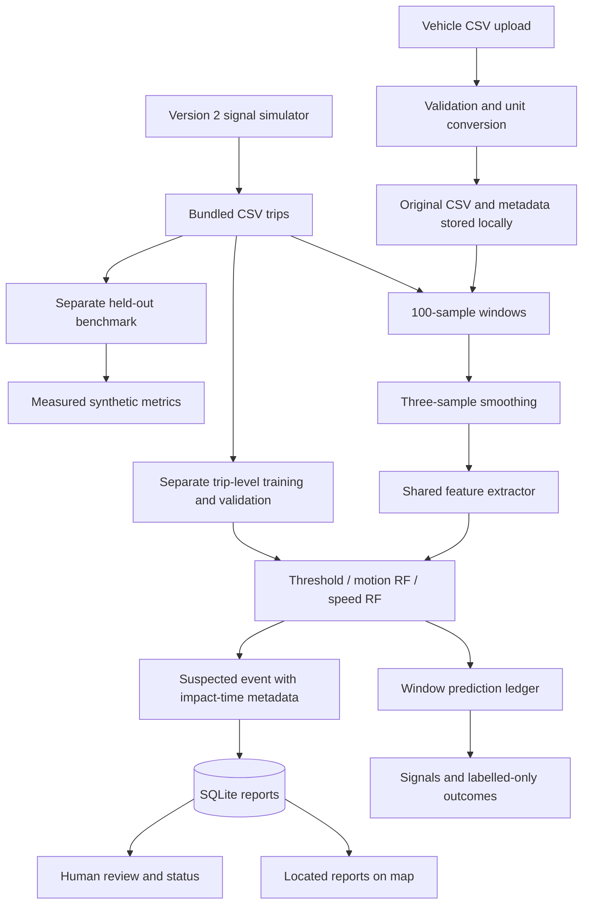

<<<<<<< HEAD
# pothole_detection
Part of the ESD Take Home assignment
=======
# RoadWatch

A local workspace for analyzing vehicle motion recordings, reviewing suspected road events, and comparing pothole detectors. The application accepts sensor CSV files and includes an explicitly synthetic demonstration. No connected hardware is needed to explore the software.

**Sensor input can be real; the bundled models are still trained on synthetic signals. Importing a recording does not make the model road-validated.** Missing GPS, speed, labels, and photographic evidence remain missing rather than being fabricated.

## Run

```bash
cd /Users/atharv/projects/es_takehome_project
source .venv/bin/activate
streamlit run app.py --server.address 127.0.0.1 --server.port 8501
```

Open http://127.0.0.1:8501. Stop with Ctrl+C. A fresh checkout needs:

```bash
python3 -m venv .venv
source .venv/bin/activate
pip install -r requirements.txt
python bootstrap.py
streamlit run app.py --server.address 127.0.0.1
```

Python 3.9+; the lock file records the tested dependency environment. Retrain local sklearn pickle artifacts after changing dependencies. Only load trusted, locally generated models.

## Workspace

- **Trip workspace:** Full-recording signal preview, compact playback controls, two-second window processing, decision features, and prediction ledger. Analyze full trip processes remaining windows with the chosen detector. New analysis preserves existing reports and starts a separate run.
- **Map & reports:** Review-state filters, per-recording scope, coordinate pins, click-to-inspect popups, source labels, JSON/GeoJSON exports, and persistent review status. Unlocated events remain in the ledger, without invented map pins.
- **Investigation:** Three-axis signal view, side-by-side detector predictions, disagreement, peak/threshold comparison, global feature importance, and processed-window metrics only where labels exist.
- **Model validation:** The held-out synthetic benchmark, clearly separate from whichever recording is selected. Shows actual regenerated precision, recall, F1 and confusion matrices.
- **Import recording:** Upload, choose units and provenance, inspect quality warnings, confirm the mounting/gravity contract, and save locally. The saved recording becomes active. Files remain available after restart.
- **System notes:** A concise explanation of architecture, assumptions, and provenance for the classroom demo.

## Vehicle sensor CSV contract

Yes: a vehicle logger can export a CSV and the software can import it. This first import version deliberately uses a strict input contract so incompatible recordings are not silently processed with the wrong assumptions.

Required columns:

| Column | Meaning |
| --- | --- |
| `timestamp` | Numeric elapsed seconds or milliseconds, selected during import; strictly increasing |
| `ax`, `ay`, `az` | Vehicle-aligned, gravity-removed acceleration; z is vertical; m/s² or g, selected during import |
| `gx`, `gy`, `gz` | Angular velocity in rad/s or deg/s, selected during import |

Optional columns:

| Column | Behaviour |
| --- | --- |
| `speed_kmh` | Nonnegative speed in km/h; all usable samples need speed for the speed-aware model |
| `latitude`, `longitude` | Decimal degrees; incomplete pairs become unlocated; no interpolation or default location |
| `label` | `normal`, `pothole`, `speed_breaker`, `rough_road`; absent, mixed, or partial window labels are excluded from metrics |
| `trip_id` | Optional; if supplied must identify one trip per file |

Headers are stripped and lowercased. Other columns are ignored by inference. Sample rate must be 50 Hz ±5% with each interval within 6 ms of 20 ms. Recordings with larger jitter or gaps must be split/resampled externally; the importer does not invent missing motion samples. Limits: 10 MB and 100,000 samples. Full windows contain 100 samples; incomplete trailing samples are disclosed and excluded. For a large trip, split into shorter recordings with the same units and sampling contract.

Example header:

```csv
timestamp,ax,ay,az,gx,gy,gz,speed_kmh,latitude,longitude,label
```

A complete **synthetic** format example can be downloaded in Import recording. Declare it as Synthetic / generated when uploading. The software does not authenticate whether an uploaded file is a true vehicle recording: provenance is the user's declaration.

Raw accelerometer gravity removal and orientation compensation must happen upstream. Do not just subtract 9.81 from arbitrary device z if the sensor orientation changes. The app requires the stated fixed, vertical alignment; it does not estimate sensor orientation.

### Import and data quality

1. The uploader reads a bounded UTF-8 comma-separated file and checks required channels.
2. Selected units are converted to seconds, m/s² and rad/s. The initial time is subtracted; its original value is retained in metadata.
3. Invalid motion samples, non-increasing time, unsupported rates/gaps, invalid coordinates/speed, multiple trips, and unknown labels produce actionable errors.
4. Missing optional columns stay missing. Mixed-label windows do not receive a guessed majority label.
5. A user confirms fixed mounting, vertical z, and gravity removal before saving.
6. Original bytes and metadata are retained under `.runtime/imports/`. Dataset identity hashes the file plus unit/provenance options, so different interpretations cannot silently share an analysis identity.
7. The active recording uses the shared inference pipeline; imports never retrain or modify held-out validation results.

## Architecture



Training and inference use exactly the same preprocessing and feature functions. Features: absolute peak vertical acceleration, peak-to-peak, RMS, variance, gyro RMS, active fraction above 1 m/s², sign-change fraction; the speed-aware model adds mean speed. Labels, GPS and trip/window identifiers do not enter the classifier.

Both Random Forests use 120 trees, max depth 9, minimum leaf size 2 and random seed 42. The threshold is selected from 1.0–8.0 m/s² in 0.1 increments on validation trips only. A complete two-second window is needed before inference; this is not instantaneous impact detection.

Pothole and speed-breaker predictions produce reports with a stable UUID per run/dataset/window. Impact time is estimated from peak absolute raw vertical acceleration. The location and speed are taken from that sample if supplied. Missing fixes are not backfilled. Original upload provenance and `model_source=synthetic` are recorded separately. No camera evidence is generated for new reports. Category-matched sample photos may be shown in map popups and are labelled as illustrations. Existing legacy illustration references remain preserved as historical simulation records.

SQLite insertion is idempotent within a run. It does not merge adjacent positive windows or prove repeated observations represent one physical pothole. New runs intentionally retain separate observations.

## Simulation version 2

The original equally spaced, class-cycling demonstration was replaced with more varied artificial signals:

- A continuous speed profile with changes between acceleration, cruising and braking.
- Longitudinal acceleration and lateral/yaw components related to that speed and heading profile.
- Randomized, imbalanced classes: approximately 67% normal, 12% pothole, 9% speed breaker, 12% rough road.
- Variable pulse amplitude, width, rebound, damping and mounting/suspension factors.
- Background vibration, correlated noise, and road-joint impulses as non-pothole examples.
- GPS positions derived from integrated speed and heading, updated at 1 Hz with meter-scale jitter and occasional lost fixes.

This is a more challenging software simulation, **not a calibrated vehicle model**. Events remain assigned to two-second windows; the trajectory is not matched to a real street network; GPS noise is simplified; speed still influences generated vibration by construction. None of these changes establishes real-road accuracy.

The generator produces 21 deterministic trips of 60 windows (120 seconds each): training trips 0–11, validation 12–15, test 16–19, demo 20. No trip crosses splits. The held-out benchmark contains 240 windows. Same-generator testing limits external validity even with disjoint trips. `results/metrics.json` is the authoritative measured output. Old version-1 scores are superseded.

## Maps and privacy

Leaflet 1.9.4 JavaScript/CSS/license are vendored in `ui/vendor`. Attributed OpenStreetMap street tiles require internet. The map requests tiles only in the map view; turning off Street basemap leaves coordinate pins on a neutral background. The provider receives the viewed geographic area through tile requests, not full report payloads. No tile scraping or prefetching is implemented.

Report pins use stored coordinates. Exact overlapping coordinates share a count and popup; color is taken from the selected or newest report in that group. This is display grouping, not defect clustering or severity scoring. All stored reports can include legacy and mixed-provenance datasets. The active-recording scope separates current data by dataset hash. Route breaks are retained at observed missing GPS samples; route rendering is decimated to one sample per second. A GPS field supplied by the logger is not proof of fix freshness; the logger should leave unavailable fixes blank.

Raw uploaded recordings and reports stay in the project directory. Uploaded files are retained only after Save recording. This application is intended for a trusted local user and binds to localhost; it is not an authenticated multi-user service.

## Files and responsibilities

| File | Responsibility |
| --- | --- |
| `app.py` | Navigation, recording selection/import, playback, map/report review, investigation, benchmark |
| `.streamlit/config.toml` | Native light theme, upload limit, disabled telemetry |
| `config.py` | Paths, classes, features, window settings, review states |
| `bootstrap.py` | Regenerate synthetic trips, retrain, evaluate |
| `simulation/generate_data.py` | Version-2 artificial signals, GPS and split manifest |
| `simulation/import_csv.py` | Bounded CSV parsing, units, schema/timing checks, provenance, window labels |
| `simulation/replay.py` | Legacy demo-loader helper for direct Python use |
| `processing/preprocess.py` | Required-motion and optional-metadata validation; smoothing |
| `processing/features.py` | Shared features; missing speed remains unavailable |
| `processing/detector.py` | Local models and threshold; rejects speed model without complete speed |
| `processing/events.py` | Stable event IDs, impact association, source/model provenance, missing metadata |
| `storage/database.py` | SQLite report storage and review-state validation |
| `ui/workspace.py` | Signal plots, route points/gaps, numerical formatting |
| `ui/maps.py` | Coordinate validation, Leaflet HTML, safe popups, GeoJSON |
| `ui/insights.py` | Labelled-only binary outcomes and stored-report summaries |
| `ml/train.py` | Model fitting and validation-only threshold selection |
| `ml/evaluate.py` | Held-out metrics and confusion matrices |
| `tests/` | Import, provenance, timing, feature/inference contracts, persistence, maps, UI navigation |
| `data/manifest.json` | Generator provenance, units and trip splits |
| `data/scenarios/` | Generated artificial CSVs |
| `data/sample_images/` | Legacy explicitly illustrative assets; no new evidence is synthesized |
| `models/` | Local trained artifacts and metadata |
| `results/metrics.json` | Actual held-out synthetic evaluation |
| `.runtime/imports/` | Saved original uploads and metadata, excluded from Git |
| `.runtime/reports.sqlite3` | Durable reports, excluded from Git |

## Verification and maintenance

```bash
python bootstrap.py
python -m unittest discover -s tests -v
```

Bootstrap overwrites generated datasets/models/metrics, never uploaded files or reports. Restart Streamlit after model, code or configuration changes. The app invalidates cached models and demo data using file modification times, but a restart is the clearest workflow after a full regeneration.

No GPS? Motion analysis still works; the report stays unlocated. No speed? Choose motion-only or threshold. No labels? Predictions and signal exploration work; accuracy statistics remain unavailable. No internet? Disable street tiles. Unsupported sample rate? Configure the logger for 50 Hz or resample externally and record that preprocessing. To delete a stored import, stop the app and deliberately remove its paired CSV/JSON files from `.runtime/imports`; saved reports remain historical evidence.

Next steps: collect independently labelled recordings; evaluate across separate trips/vehicles; add timestamped camera evidence; merge adjacent detections with validated rules; calibrate probabilities; add actual acknowledged upload/retry synchronization. Do not claim physical depth, severity, traffic impact, or field reliability from these simulation results.

Update this README's contracts, architecture, limitations and file overview whenever the corresponding implementation changes.

## Sample photos in map popups

Map popups show a category-matched image from `pothole_images/` or `speedbreaker_images/` at the project root. The detector's predicted class determines the folder; the report ID determines a stable pseudorandom choice within that folder. The choice remains stable across reloads while the folder contents remain unchanged. Existing reports receive sample photos at display time without changing stored evidence. New analyses save both pothole and speed-breaker reports; normal and rough-road windows remain in the prediction ledger only. Threshold detection cannot classify speed breakers.

Images are labelled **Sample image — not event evidence**, including for imported recordings. They are not synchronized with the event or used for prediction. The app embeds locally generated thumbnails in the map HTML; original images are never overwritten. Supported formats: JPEG, PNG, WebP and AVIF where Pillow can decode it. Missing, unreadable and oversized images are skipped; absent categories get an explicit empty message. Thumbnails are cached by path, modification time and size. Repeated reports reuse one embedded image payload. No external image hosting is required.

`ui/sample_images.py` handles image selection and thumbnails. `ui/maps.py` renders the labelled photo above report details. GeoJSON and JSON exports keep original report data and do not embed sample photos. Use Detected categories in Map & reports to show potholes, speed breakers, or both. Run New analysis → Analyze full trip to generate speed-breaker reports for a previously analyzed recording.
>>>>>>> c2393bd (basic demo prototype completed)
